<p align="center">
  
</p>

<p align="center">
  <a href="https://crates.io/crates/botwright"></a>
  <a href="https://docs.rs/botwright"></a>
  <a href="https://github.com/thesn10/botwright/actions/workflows/ci.yml"></a>
  <a href="https://crates.io/crates/botwright"></a>
  
  
</p>

# botwright

A Rust framework for event-driven bots (MEV, liquidations, keepers, arbitrage, monitoring) built on
the **collector → strategy → executor** pattern popularised by
[Artemis](https://github.com/paradigmxyz/artemis).

- **Collectors** turn external sources into a stream of events. They reconnect with backoff and
  resume from their last cursor, backfilling what they missed.
- **Strategies** hold state, process one event at a time and submit actions. Long work runs in
  opportunity tasks the engine supervises.
- **Executors** execute actions with bounded concurrency and an optional timeout. Results flow back
  as events, not return values.

What botwright adds on top of the pattern:

- **Explicit delivery per subscription:** `Lossless` (default), `DropNewest`, `DropOldest` or
  `Latest`. Dropping is never silent, backpressure is reported, and a stuck channel can end the
  engine instead of stalling it.
- **Gaps and reorgs are first-class:** collectors report `GapFilled` / `GapUnfilled`; the EVM
  collectors detect reorgs and retract logs of dropped blocks.
- **A failure policy that does not trade on corrupt state:** a panicking strategy either ends the
  engine or is rebuilt from a factory.
- **Orderly shutdown** with one deadline, **metrics**, `/healthz`, non-blocking **notifications**,
  and a deterministic **replay harness** for tests.

The exact guarantees are listed in [docs/guarantees.md](docs/guarantees.md).

## Quickstart

```toml
[dependencies]
botwright = "0.1"
tokio = { version = "1", features = ["macros", "rt-multi-thread"] }
```

```rust
use std::time::Duration;

use botwright::{
    BoxError, CollectorOpts, Delivery, Engine, Envelope, ExecutorOpts, IntervalCollector,
    PrintExecutor, Strategy, StrategyCtx, Tick,
};

#[derive(Debug)]
struct Event(Tick);

impl From<Tick> for Event {
    fn from(tick: Tick) -> Self {
        Self(tick)
    }
}

#[derive(Debug)]
struct Report(u64);

struct EveryFifth;

impl Strategy<Event, Report> for EveryFifth {
    fn name(&self) -> &str {
        "every-fifth"
    }

    async fn on_event(&mut self, event: &Envelope<Event>, ctx: &mut StrategyCtx<Report>) -> Result<(), BoxError> {
        let Event(tick) = &*event.event;
        if tick.n % 5 == 0 {
            ctx.submit(Report(tick.n)).await?;
        }
        Ok(())
    }
}

#[tokio::main]
async fn main() -> Result<(), BoxError> {
    let engine = Engine::<Event, Report>::builder()
        .collector(IntervalCollector::new("clock", Duration::from_millis(200)), CollectorOpts::default())
        .strategy(EveryFifth, |sub| sub.from("clock", Delivery::Latest))
        .executor(PrintExecutor::default(), ExecutorOpts::default())
        .build()?;
    let exit = engine.run().await; // until Ctrl-C
    println!("{exit}");
    Ok(())
}
```

An EVM bot looks the same with different building blocks:

```rust
let engine = Engine::<Event, Action>::builder()
    .collector(BlockCollector::ws("blocks", &ws_url), CollectorOpts::default())
    .collector(LogCollector::ws("logs", &ws_url, filter), CollectorOpts::default())
    .collector(feedback, CollectorOpts::default())
    .strategy(Liquidator::new(config), |sub| {
        sub.from("blocks", Delivery::Latest)
            .from("logs", Delivery::Lossless { capacity: 4096 })
            .from("tx-feedback", Delivery::default())
    })
    .executor(
        TransactionExecutor::new("tx", signer, &http_url)?.feedback(feedback_sender),
        ExecutorOpts::default().concurrency(4).timeout(Duration::from_secs(5)),
    )
    .build()?;
```

## Examples

| Example | Shows |
|---|---|
| [`interval_printer`](examples/interval_printer.rs) | the smallest bot |
| [`block_logger`](examples/block_logger.rs) | `BlockCollector` with reorg events |
| [`logs_dry_run`](examples/logs_dry_run.rs) | logs → strategy → `PrintExecutor`, with removed logs |
| [`replay_test`](examples/replay_test.rs) | deterministic replay with `Harness` |
| [`feedback_loop`](examples/feedback_loop.rs) | `TransactionExecutor` feeding results back through a `ChannelCollector` |

```sh
cargo run --example interval_printer
cargo run --example replay_test --features test-util
anvil --block-time 1 & RPC_WS=ws://127.0.0.1:8545 cargo run --example block_logger
```

## Features

| Feature | Contents | Default |
|---|---|---|
| (core) | engine, traits, `IntervalCollector`, `ChannelCollector`, `MapCollector`, `PrintExecutor`, `NoopExecutor`, `LogNotifier`, `QueuedNotifier`, backoff | always |
| `evm-alloy1` | `botwright::eth` on alloy 1.x: block, log, full-block and polling collectors, transaction executors | yes |
| `evm-alloy2` | the same on alloy 2.x; excludes `evm-alloy1` | no |
| `mempool` | `MempoolCollector` | no |
| `hypersync` | `HyperSyncBackfill` for `LogCollector` | no |
| `bundles` | `BundleExecutor` (`eth_sendBundle`) | no |
| `telegram` | `TelegramNotifier` | no |
| `metrics` | metrics through the [`metrics`](https://docs.rs/metrics) facade | no |
| `http` | `/healthz` and Prometheus `/metrics` | no |
| `signal` | shutdown on SIGINT and SIGTERM | yes |
| `test-util` | `ReplayCollector`, `RecordingCollector`, `CapturingExecutor`, `Harness` | no |

For alloy 2.x:

```toml
botwright = { version = "0.1", default-features = false, features = ["evm-alloy2", "signal"] }
```

Code written against `botwright::eth` compiles unchanged with both backends. The alloy crate in use
is re-exported as `botwright::eth::alloy`.

## Minimum supported Rust version

Rust 1.90 for the core and `evm-alloy1`. Newer alloy releases raise the bar: alloy 1.7 and later
need Rust 1.91, alloy 2.x needs Rust 1.94.1. With the MSRV-aware resolver (the default for
edition 2024 and for packages that set `rust-version`), cargo picks an alloy 1.x that fits your
toolchain.

## License

Licensed under any of

- [The Unlicense](UNLICENSE)
- [MIT license](LICENSE-MIT)
- [Apache License, Version 2.0](LICENSE-APACHE)

at your option.

### Contribution

Unless you explicitly state otherwise, any contribution intentionally submitted for inclusion in
the work by you shall be licensed as above, without any additional terms or conditions.
